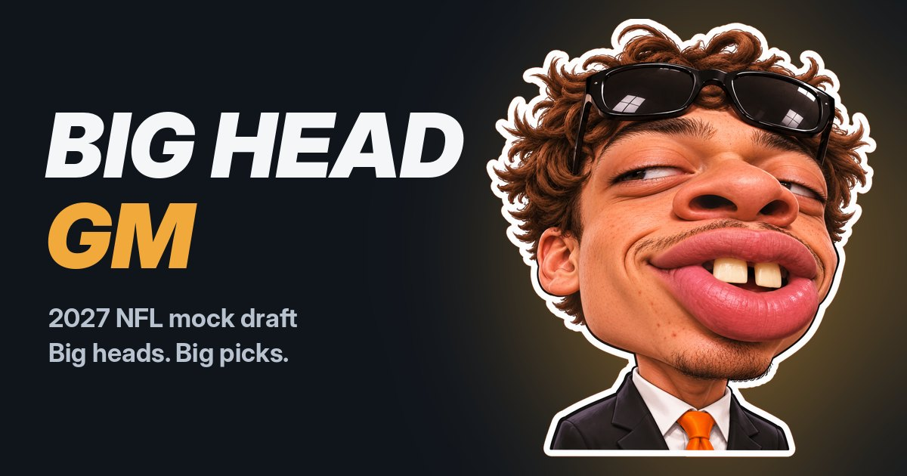

# Big Head GM

**A free 2027 NFL mock draft simulator. Big heads. Big picks. Make your draft.**

▶ **Play it at [bigheadgm.com](https://bigheadgm.com)**, on your phone or computer. No sign-up.



Pick a team, draft against 31 cartoon GMs who draft for their own needs, trade up or down, then see how your class grades out against the whole league.

## Features

- **Real 2027 data:** 361 prospects, all 257 picks in the current draft order (traded and compensatory picks included), and the top needs for every team
- **32 original GMs:** every team has its own big-headed 3D GM who reacts to your picks with five moods (smug, thinking, laughing, shocked and yelling) and a catchphrase
- **Smart computer teams:** they balance best player available against team needs, with some randomness so no two mocks are the same
- **Draft style:** a slider from Chalk to Chaos for how predictable the computer teams are, plus Slow to Instant pick speed
- **Pick labels:** every pick is tagged STEAL, Value, Fair or Reach by comparing where the player went to his big board rank
- **Player cards:** tap any player to see his rank, size, where he usually goes, the top players at his position and which teams need one next
- **Trades:** trade down when you're on the clock, or trade up before your pick, priced with a draft value chart
- **Grades:** every team gets a letter grade on a curve at the end
- **Share my draft:** one tap makes a picture of your class and grade to text or post
- **My mocks:** your last 10 drafts are saved on your device
- **Works everywhere:** phone layout, a three-column draft room on computers, installable on your home screen, and works offline

## How the website works

The website is plain HTML, CSS and JavaScript in the `docs` folder, hosted free by GitHub Pages at bigheadgm.com.

| File | What it does |
|---|---|
| `docs/index.html` | The page: home, setup, draft room and grades screens |
| `docs/app.js` | The draft: computer picks, trades, grades, player cards, saved mocks, sharing |
| `docs/gm.js` | Shows the right GM photo for each team and mood (and draws a cartoon backup if a photo can't load) |
| `docs/gm/` | The GM photos: one sheet per mood with all 32 teams, and one strip per team with all 5 moods |
| `docs/style.css` | How everything looks, on phones and computers |
| `docs/sw.js` | Saves the site on your device so it works offline |
| `docs/manifest.json` | Lets you add it to your home screen like an app |
| `docs/data/*.json` | Prospects, teams, draft order and trade chart (made by `export_json.py`) |
| `docs/icons/` | Logo, mascot, home screen icons and the link preview image |
| `docs/CNAME` | Connects the site to bigheadgm.com (don't delete it) |

To run the website on your computer:

```
cd docs
python3 -m http.server
```

Then open http://localhost:8000.

## The Python simulator

The site started as a terminal app, and the Python version still works. It's also where the data gets updated.

```
cd mockdraft
python3 mock_draft.py
```

1. Choose your team (or press Enter to watch the computer draft) and how many rounds (1–7).
2. At the start of each round, type a pick number to try trading up, or press Enter.
3. When you're on the clock, type a **rank number** to draft that player, a **position** (like `WR`) to filter the board, `more` to see more players, or `T` for trade-down offers.

| File | What it does |
|---|---|
| `mock_draft.py` | Runs the draft (run this one) |
| `auto_mocks.py` | Runs lots of computer-only drafts and prints a summary |
| `export_json.py` | Turns the CSV files into the JSON the website uses |
| `convert_board.py` | Rebuilds `players.csv` from a new PFN big board export |
| `config.py` | Settings you can tweak, like how random the computer is |
| `models.py` | Player, Team and Pick |
| `data.py` | Loads the CSV files and saves results |
| `draft_logic.py` | Computer picks, value labels and grades |
| `trades.py` | Pick values and trades |
| `players.csv` | Prospects: rank, name, position, college |
| `teams.csv` | Each team's needs, most important first |
| `draft_order.csv` | Every pick: round, pick number, team, original team |
| `trade_chart.csv` | Point value of every pick, modeled on the Jimmy Johnson chart |

### Updating the data

1. Update the CSV files in `mockdraft` (or run `convert_board.py` on a new big board export).
2. Run `python3 export_json.py` to rebuild the files in `docs/data`.
3. Upload the new `docs/data` files to GitHub. The site updates in a minute or two.

## Data sources

- Big board: Pro Football Network consensus board
- Draft order: Tankathon
- Team needs: NFL.com

Data was last updated November 2026. Rankings and the draft order change every week, so mocks reflect the season so far.

Big Head GM is not affiliated with the NFL or any NFL team. Every GM is an original character, with team colors and no logos.
